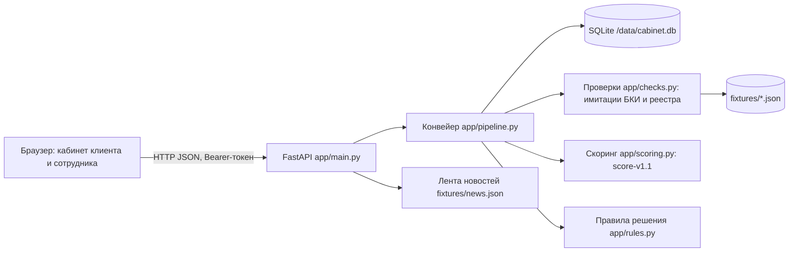

# Архитектура

Принципы
- Решение принимает сервер (`rules.decide`); интерфейс только показывает результат.
- Права проверяются на сервере: клиент видит только свои заявки, решения и уточнения — только сотрудник.
- Переходы статусов проходят через `pipeline.move` (проверка допустимости + защита от гонок и двойного клика).
- Сбой проверки или скоринга ведёт к ручному рассмотрению, не к одобрению.
- Все внешние системы заменены локальными имитациями; платных API и LLM нет.
- Скоринг — Python-модуль внутри бэкенда; выделять в сервис только при необходимости.

Конфигурация — переменные окружения (`app/config.py`, `.env.example`).
