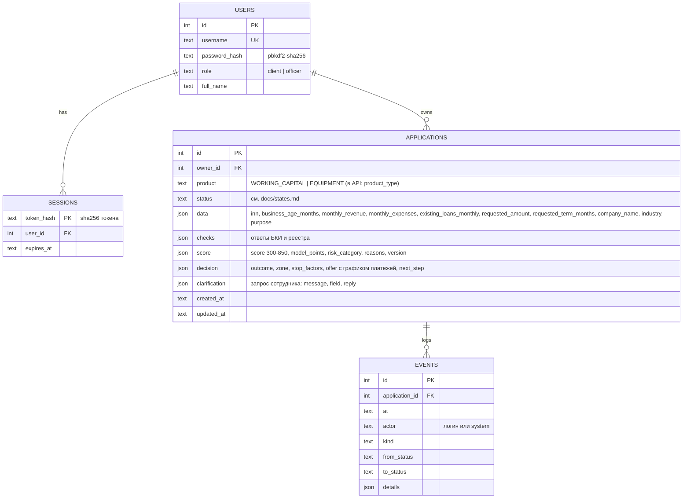

# Модель данных

Схема в коде: `app/db.py` (SQLite). Вложенные объекты хранятся как JSON-текст.

Плановые сущности «компания» и «проверка» в MVP вынесены в JSON заявки (`data`, `checks`), чтобы не усложнять схему.
