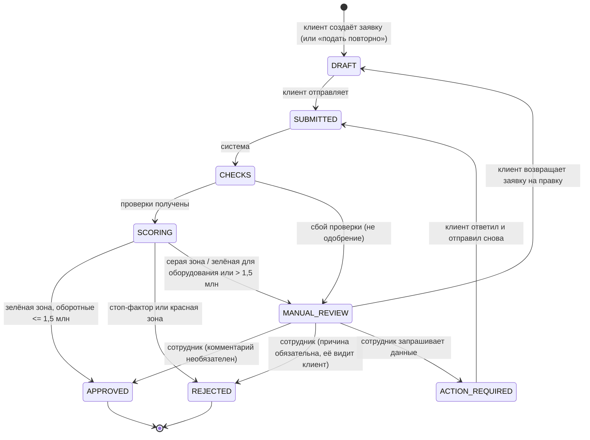

# Диаграмма состояний заявки

Источник истины в коде: `app/states.py` (`TRANSITIONS`). Переходы проверяются на сервере. Коды статусов совпадают со спецификацией бизнес-аналитика.

| Код | Название в интерфейсе | Кто двигает |
|---|---|---|
| DRAFT | Черновик | клиент (автосохранение каждые 2 с) |
| SUBMITTED | Отправлена | клиент |
| CHECKS | Проверки | система |
| SCORING | Оценка | система |
| ACTION_REQUIRED | Нужны данные | сотрудник -> клиент |
| MANUAL_REVIEW | Ручное рассмотрение | сотрудник |
| APPROVED | Одобрено | система или сотрудник |
| REJECTED | Отказ | система или сотрудник |

## Матрица решений (`app/rules.py`, спецификация п. 2.1)
| Зона балла | Стоп-фактор | Продукт | Действие | Итог |
|---|---|---|---|---|
| любая | есть | любой | автоматический отказ | REJECTED |
| красная (< 520) | любые | любой | автоматический отказ | REJECTED |
| серая (520-679) | нет | оборотные | кредитный аналитик: дозапрос выписки или меньшая сумма | MANUAL_REVIEW |
| серая (520-679) | нет | оборудование | кредитный аналитик: дозапрос спецификации залога | MANUAL_REVIEW |
| зелёная (>= 680) | нет | оборотные <= 1,5 млн | экспресс-одобрение | APPROVED |
| зелёная (>= 680) | нет | оборудование или > 1,5 млн | верификация залога сотрудником | MANUAL_REVIEW -> APPROVED |

## Редактирование заявки
- **Черновик и «Нужны данные»:** клиент правит поля свободно, изменения автосохраняются.
- **Ручное рассмотрение:** кнопка «Изменить заявку» (`POST /applications/{id}/edit`) возвращает заявку в черновик. Результаты проверок и оценки сбрасываются, после правок заявка проходит весь конвейер заново. В очереди сотрудника она на это время не видна. История событий сохраняется.
- **Одобрено или отказ:** заявку менять нельзя (решение принято). Кнопка «Создать новую заявку на основе этой» (`POST /applications/{id}/repeat`) делает новый черновик с теми же данными, исходная заявка остаётся нетронутой.
- Подряд идущие автосохранения записываются в историю одной строкой.

Клиенту в статусе «Ручное рассмотрение» показывается причина (`review_reason`): серая зона, проверка залога оборудования, сумма выше лимита экспресс-одобрения или недоступность автоматических проверок.

Стоп-факторы: срок ИП меньше 6 месяцев; действующая просрочка по БКИ; ИП не действует по реестру.
Решение отделено от риска: балл (`app/scoring.py`) — только оценка, решение принимают правила.
